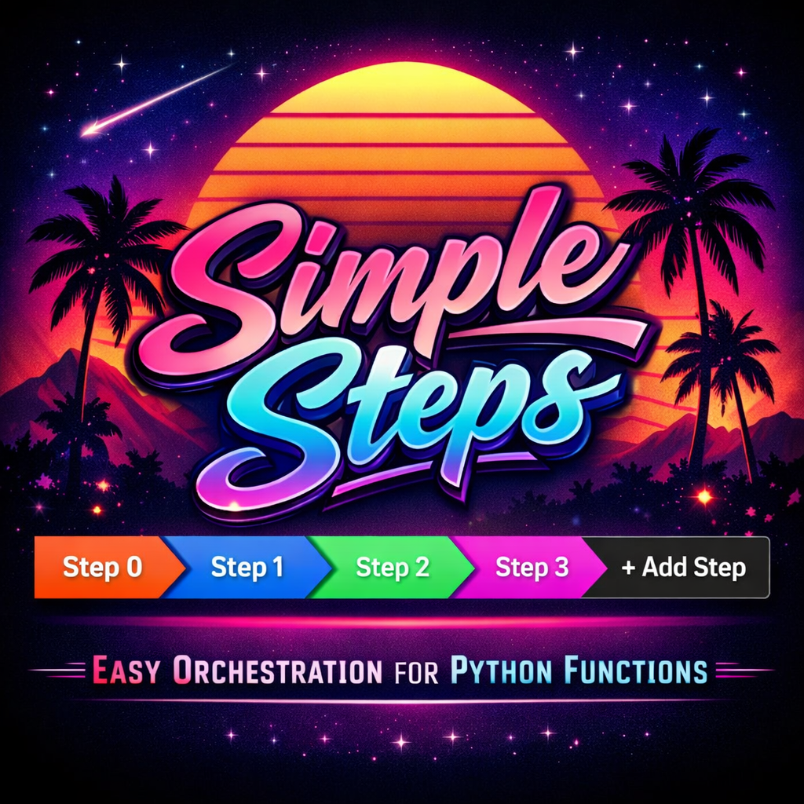

# Simple Steps

<p align="center">
  
</p>

A visual workflow tool that lets non-technical users build and run multi-step data pipelines — backed by plain Python functions.

Think of it as a spreadsheet where every cell is a Python operation, every column is a pipeline step, and every row is a piece of data flowing through it.

---

## What It Does

You define operations as ordinary Python functions. Simple Steps wraps them in a React UI where users can:

- **Build pipelines** by chaining steps in a visual canvas
- **Wire data** between steps using a formula bar (`=extract_metadata[mod.map()](wf["videos"])`)
- **Run steps** individually or as a full pipeline, seeing live row-by-row output
- **Save and reload** workflows as portable JSON files
- **Export** any workflow as a plain Python script — the formula syntax is valid Python

The formula bar is the single source of truth. The UI controls (dropdowns, parameter fields) just edit the formula — they never hold independent state.

---
## Installation

### From GitHub

```bash
pip install git+https://github.com/stusynakowski/Simple_Steps.git
simple-steps
```

### Updating an existing install — read this

`simple-steps` (`0.0.0`) and `simple-steps-core` (`0.1.0`) rarely change version, so
**a plain `pip install git+...` on a machine that already has them does
nothing** — pip sees the installed copy as satisfying the requirement and keeps
your old code. `pip install --upgrade` does not help either, for the same
reason.

To actually update:

```bash
pip install --upgrade --force-reinstall --no-cache-dir \
  "git+https://github.com/stusynakowski/Simple_Steps.git"
```

Check what you really have — the commit, not the version:

```bash
simple-steps --version
#   simple-steps       0.0.0 (git 5597c025ae78)
#   simple-steps-core  0.1.0 (git 1c30e03c9a10)
```

If `simple-steps-core` is older than `1c30e03`, you will see
`ImportError: cannot import name 'ResourceSpec'` — that is the symptom of a
stale install, and the force-reinstall above is the fix.

### Running the examples

The examples ship with the package: three small ones — `basic/` (core verbs
and data manipulation), `dummy_llm/` (resources) and `plotly_charts/` — and a
main example that uses all three. Copy them out and run one, the way you'd run
a Streamlit app:

```bash
pip install "simple-steps @ git+https://github.com/stusynakowski/Simple_Steps.git"
simple-steps --load-examples              # copies them to ./examples
simple-steps run examples/app.py          # the main example; or examples/basic/app.py, …
python examples/runme.py                  # run every example's workflows and check each step
```

Each example has saved workflows in its `workspace/`, the same workflows
written in Python, and a `runme.py` that runs both and checks they agree. See
[`src/SIMPLE_STEPS/examples/README.md`](src/SIMPLE_STEPS/examples/README.md).

`simple-steps run <file>` serves the `App` the file builds, with the file's
folder as the workspace: `--port`, `--host` and `--no-browser` win over any
`app.serve()` call in the file. A file that only defines `@simple_step_tool`
functions gets an `App` of those tools. The same command through the
interpreter is `python -m simple_steps run app.py` (a module name can't hold a
hyphen, so it's `simple_steps`, not `simple-steps`). Plotly comes with the
install, so the chart examples run as they are.

`simple-steps` on its own still starts the server for the current folder, with
the 29 built-in tools and any tools it discovers there.

In this repo the examples live in `src/SIMPLE_STEPS/examples/`, so that the
wheel carries them; `--load-examples` copies whatever that folder holds.


### Prerequisites

- **Python 3.13** — the version Simple Steps is developed and tested on (the
  repo's `.python-version`). It installs on 3.10+, but only 3.13 is tested.
- **Node.js 22 LTS** (20.19+ works) — only needed to develop the frontend or
  rebuild the UI.

### Option A: Use Simple Steps (no local repo checkout)

If you want to use the tool for a project without seeing/cloning the repository, install directly from GitHub:

```bash
python -m pip install "git+https://github.com/stusynakowski/Simple_Steps.git"
```

Optional: pin to a specific tag/release:

```bash
python -m pip install "git+https://github.com/stusynakowski/Simple_Steps.git@v0.0.0"
```

This installs the package into your environment (`site-packages`) and gives you the `simple-steps` CLI without creating a repo folder in your current workspace.

### Option B: Develop Simple Steps (full repo checkout)

If you want to work on the codebase itself:

```bash
git clone https://github.com/stusynakowski/Simple_Steps.git
cd Simple_Steps

uv venv --python 3.13        # or: python3.13 -m venv .venv
source .venv/bin/activate   # macOS / Linux
# .venv\Scripts\activate    # Windows

uv pip install -e .          # or: pip install -e .
```

That's it. The package installs the `simple-steps` CLI command and bundles a pre-built copy of the frontend.

### Option C: Add desktop mode

```bash
pip install -e ".[desktop]"
```

This adds `pywebview`, which lets you run Simple Steps as a native desktop window — no browser required. See [Desktop mode](#desktop-mode-no-browser) below.

### Option D: Add dev tools

```bash
pip install -e ".[dev]"
```

This adds `pytest` and `ruff` for running tests and linting.

### Option E: Add everything

```bash
pip install -e ".[desktop,dev]"
```

### A vs B quick guide

- Choose **Option A** when you only want to use the tool in a project and do not want a local repo checkout.
- Choose **Option B** when you want to develop Simple Steps itself and need full source visibility.

### Recommended two-environment setup (use + dev)

```bash
# 1) Use environment (no repo checkout in your project folders)
conda create -n simple_steps_use python=3.11 -y
conda activate simple_steps_use
python -m pip install "git+https://github.com/stusynakowski/Simple_Steps.git@v0.0.0"

# 2) Dev environment (full repo, editable install)
conda create -n simple_steps_dev python=3.11 -y
conda activate simple_steps_dev
git clone https://github.com/stusynakowski/Simple_Steps.git
cd Simple_Steps
python -m pip install -e ".[desktop,dev]"
```

With this split, your day-to-day usage stays clean, and your development environment stays fully inspectable.

---

## Running Simple Steps

### One command

```bash
simple-steps
```

This starts the backend API **and** serves the frontend UI on a single port. Your browser opens automatically.

```
  ┌─────────────────────────────────────────┐
  │         ⚡ Simple Steps v0.0.0 ⚡        │
  ├─────────────────────────────────────────┤
  │  Backend API: http://127.0.0.1:8000/api  │
  │  Frontend UI: http://127.0.0.1:8000      │
  │  Docs:        http://localhost:8000/docs  │
  └─────────────────────────────────────────┘
```

Open [http://localhost:8000](http://localhost:8000) to use the UI, or [http://localhost:8000/docs](http://localhost:8000/docs) for the interactive API docs.

### Your own application: `app.py`

Put your tools and resources in your own files, then list them in an `app.py`
next to them. Everything else has a default.

```python
# app.py
from SIMPLE_STEPS import App, Loaded, env
import my_tools                                # your @simple_step_tool functions
from my_resources import ClinicalDB            # your @simple_step_resource classes

app = App(
    tools=[my_tools],
    resources=[ClinicalDB],
    loaded={"study": Loaded(ClinicalDB, url="postgres://study",
                            api_key=env("DB_KEY"), locked=["url"])},
)

if __name__ == "__main__":
    app.serve()
```

Start it with `python app.py`, or run `simple-steps` in that folder: the server
finds `app.py` and serves the `App` it defines. Tools come only from the
`App`'s `tools=[…]` and the standard set: nothing else in the folder is
imported. Without an `app.py`, the standard tools are offered.

| `App(…)` setting | default |
|---|---|
| `tools` | none: the standard tools only |
| `resources`, `loaded` | none |
| `workspace` | the folder `app.py` is in |
| `title`, `host`, `port` | `"Simple Steps"`, `127.0.0.1`, `8000` (the next free port if taken) |
| `cell_types` | the built-in cell types (images, Plotly, tables, JSON) |
| `freeze` | `False`; `True` refuses new tools once the server is up |
| `agent` | a local Ollama model if one is running (`llama3.2:3b`); `Agent(model="qwen2.5:7b")` to choose; `False` for none |

### The agent

The chat panel's agent **proposes** steps; you choose which to keep, apply
them, and run them. It never runs anything itself, and every formula it
proposes is checked (it compiles, reads only earlier steps, uses only your
tools and resources) before you see it. It runs on a local
[Ollama](https://ollama.com) model:

```bash
ollama pull llama3.2:3b      # small; a 7–8B model (qwen2.5:7b) gives better proposals
```

Without a model the app works as usual and the panel says why the agent is off.

### Desktop mode (no browser)

Run Simple Steps as a **native desktop window** — same exact UI, no browser required. A native OS window opens using [pywebview](https://pywebview.flowrl.com/), and the working directory you launch from becomes the workspace root.

#### Install

```bash
# If you haven't already:
pip install -e ".[desktop]"
# or just add pywebview to an existing install:
pip install pywebview
```

#### Launch

```bash
# Dedicated command:
simple-steps-local

# Or as a flag on the main CLI:
simple-steps --local
```

That's it — a native window opens with the full Simple Steps UI. The directory you `cd` into before running the command is the workspace shown in the app.

```
  ┌─────────────────────────────────────────────┐
  │       ⚡ Simple Steps v0.0.0 (Desktop) ⚡     │
  ├─────────────────────────────────────────────┤
  │  Mode:        Native window (pywebview)      │
  │  Backend API: http://127.0.0.1:8000/api      │
  │  Workspace:   /Users/you/my-data-project     │
  │    📋 2 project(s), 5 pipeline(s)            │
  └─────────────────────────────────────────────┘
```

#### Desktop-specific flags

| Flag | Description | Default |
|---|---|---|
| `--width PX` | Window width in pixels | `1280` |
| `--height PX` | Window height in pixels | `860` |
| `--title TEXT` | Custom window title | `Simple Steps — <workspace>` |
| `--debug` | Enable right-click → Inspect (web dev tools inside the window) | off |

All other flags (`--port`, `--host`, `--workspace`, `--projects-dir`) work identically to the browser version.

#### How it works

1. The FastAPI backend starts in a background thread on `127.0.0.1:<port>`
2. If the preferred port (default 8000) is busy, a free port is auto-selected
3. Once the backend is ready, a native window opens pointing at the local server
4. When you close the window, the entire process exits cleanly

#### Desktop examples

```bash
# Open from a specific project directory
cd ~/my-analysis-repo
simple-steps-local

# Custom window size
simple-steps-local --width 1600 --height 1000

# Use a workspace other than cwd
simple-steps-local --workspace ~/shared-team-repo

# With a custom title
simple-steps-local --title "Team Pipeline Tool"

# Enable dev tools (right-click → Inspect in the window)
simple-steps-local --debug

# Via the main CLI shortcut
simple-steps --local --port 9000
```

> **Tip:** Desktop mode is great for demos, workshops, or shipping Simple Steps to non-technical users who don't want to open a browser. The UI is pixel-for-pixel identical.

### CLI options

| Flag | Description | Default |
|---|---|---|
| `--port PORT` | Server port | `8000` |
| `--host HOST` | Bind address (`0.0.0.0` for all interfaces) | `127.0.0.1` |
| `--dev` | Enable auto-reload on Python file changes | off |
| `--no-browser` | Don't auto-open the browser on start | off |
| `--local` | Launch as a native desktop window instead of a browser (requires `pip install simple-steps[desktop]`) | off |
| `--workspace DIR` | Workspace root (its `projects/` holds the workflows; its `app.py` is served) | current directory |
| `--projects-dir DIR` | Directory for saved workflows | `<workspace>/projects` |

### Examples

```bash
# Custom port, don't open browser
simple-steps --port 9000 --no-browser

# Launch as a native desktop window
simple-steps --local

# Dev mode with auto-reload
simple-steps --dev

# Bind to all interfaces (e.g. for Docker or remote access)
simple-steps --host 0.0.0.0 --port 8080

# Store projects in a custom directory
simple-steps --projects-dir ~/my_pipelines

# Run from a specific workspace root
simple-steps --workspace ~/my-analysis-repo

# Desktop window from a specific directory with custom size
simple-steps-local --workspace ~/my-analysis-repo --width 1600 --height 1000
```

### Environment variables

| Variable | Description |
|---|---|
| `SIMPLE_STEPS_WORKSPACE` | Workspace root directory (alternative to `--workspace`) |
| `SIMPLE_STEPS_PROJECTS_DIR` | Override the project storage directory (alternative to `--projects-dir`) |

---

## Development Setup

If you want to work on the frontend or run the backend and frontend separately:

### Backend (dev mode)

```bash
pip install -e ".[dev]"
simple-steps --dev --no-browser --port 8000
```

Or manually with uvicorn:

```bash
python -m uvicorn SIMPLE_STEPS.main:app --reload --port 8000 --app-dir src
```

### Frontend (dev mode)

```bash
cd frontend
npm install
npm run dev        # Vite dev server on http://localhost:5173
```

The Vite dev server proxies API requests to `http://localhost:8000/api`. Both servers must be running during frontend development.

### Rebuild the bundled frontend

After making frontend changes, rebuild the production bundle that ships with the pip package:

```bash
python -m SIMPLE_STEPS.build_frontend
```

This runs `npm run build`, patches the API URL for same-origin serving, and copies the output into `src/SIMPLE_STEPS/frontend_dist/`.

---

## How Tools Work

A **tool** is a plain Python function, decorated and listed in your `App`:

```python
# my_tools.py
from SIMPLE_STEPS import simple_step_tool

@simple_step_tool(name="Extract Video Metadata", category="YouTube")
def extract_metadata(url: str) -> dict:
    """Fetch title, views, and author for a video URL."""
    return {"title": "...", "views": 9000, "author": "..."}
```

```python
# app.py
from SIMPLE_STEPS import App
import my_tools

App(tools=[my_tools]).serve()
```

It then appears in the formula bar's autocomplete and the Environment panel,
with its parameters read from its signature and `Args:` docstring.

### Use it in the formula bar

A step is written in core's syntax: the tool, its modifiers in brackets (the
outermost is the *shape verb*), and the step it reads.

```
=fetch_videos[mod.source()](channel_url="https://youtube.com/@mkbhd")
=extract_metadata[mod.map()](wf["videos"])
=extract_metadata(wf["videos"])              # the verb inferred from the tool
=identity[mod.select(columns=["title"])](wf["meta"])
=join(wf["meta"], wf["stats"], on="url")
```

| Verb | What the step does |
|---|---|
| `source` | runs the tool once, with no input |
| `map` | one call per row of the input |
| `filter` | keeps the rows where the tool returns `True` |
| `expand` | one row per item of the list the tool returns |
| `collapse`, `group` | many rows into one, overall or per group |
| `table` | the tool gets the whole input table |
| `select`, `drop`, `rename`, `sort`, `slice`, `distinct`, `widen` | reshape without a tool (`identity`) |

`=[1, 2, 3]`, `={"x": 1}` and `=7` are steps too: values.

---

## Workflow Files

Workflows are saved as plain JSON in `projects/`:

```json
{
  "format_version": 2,
  "name": "YouTube Analysis",
  "steps": [
    {"name": "videos", "expression": "fetch_videos[mod.source()](channel_url=\"https://youtube.com/@mkbhd\")"},
    {"name": "meta", "expression": "extract_metadata[mod.map()](wf[\"videos\"])"}
  ]
}
```

Each step is a name and its expression.

---

## Project Structure

```
Simple_Steps/
├── src/
│   └── SIMPLE_STEPS/              # The pip-installable package
│       ├── cli.py                 # `simple-steps` entry point: run, --load-examples
│       ├── examples/              # Shipped examples (basic, dummy_llm, plotly_charts, main);
│       │                          #   `simple-steps --load-examples` copies them
│       ├── example_check.py       # What the examples' runme.py scripts run and check with
│       ├── cli_dev.py             # `simple-steps-dev` — backend + Vite together
│       ├── cli_local.py           # `simple-steps-local` desktop mode (pywebview)
│       ├── build_frontend.py      # Bundle builder (python -m SIMPLE_STEPS.build_frontend)
│       ├── main.py                # FastAPI app, REST endpoints, SPA serving
│       ├── core_bridge.py         # The seam to simple-steps-core (contracts, resources)
│       ├── application.py         # App: the tools, resources and settings of an app
│       ├── decorators.py          # @simple_step_tool
│       ├── operation_formula.py   # The formula parser: core's syntax → core's operation
│       ├── kernels.py             # Each open workflow, live, as a core workflow
│       ├── engine.py              # Runs a step; stores its output for /api/data
│       ├── operations.py          # The standard tools (sources, JSON, cleaning)
│       ├── models.py              # Pydantic models
│       ├── file_manager.py        # Workflow JSON persistence
│       ├── agent/                 # LangGraph chat agent (optional extra)
│       └── frontend_dist/         # Bundled production frontend (generated)
├── frontend/                      # React + TypeScript app (source)
│   └── src/
│       ├── components/            # UnifiedToolbar, OperationColumn, Sidebar …
│       ├── hooks/                 # useWorkflow (central state)
│       ├── services/              # api.ts (REST client)
│       └── utils/                 # formulaParser.ts
├── external/
│   └── simple-steps-core/         # Submodule. The backend's heart; read-only here
├── tests/                         # pytest tests
│   └── fixtures/                  # Workflow fixtures + the PipelineRunner harness
├── docs/                          # Architecture, specs, ADRs, core proposals
├── usage_docs/                    # User + developer guides (served in the UI)
├── scripts/                       # Guardrails, coverage, install smoke test
└── pyproject.toml                 # Package config, dependencies, CLI entry points
```

---

## Testing

```bash
# Backend tests
pytest -q

# Frontend type-check
cd frontend && npx tsc --noEmit

# Frontend test suite
cd frontend && npm test
```

---

## Coverage (backend + frontend)

To run coverage for both backend (pytest) and frontend (vitest), there's a small helper script:

```bash
./scripts/run_coverage.sh
```

Notes:
- The frontend coverage run requires Node.js and npm. The script will run `npm install` in `frontend/` if needed.
- Backend coverage uses `pytest --cov=src` and prints a terminal summary.


## Documentation

| Doc | Description |
|---|---|
| [`usage_docs/developers/adding-operations.md`](usage_docs/developers/adding-operations.md) | How to define and register operations |
| [`usage_docs/developers/desktop-mode.md`](usage_docs/developers/desktop-mode.md) | Running Simple Steps as a native desktop app (no browser) |
| [`docs/introduction.md`](docs/introduction.md) | Product overview and problem statement |
| [`docs/spec/`](docs/spec/) | Feature specifications |
| [`docs/adr/`](docs/adr/) | Architecture decision records |
| [`docs/core-adoption-status.md`](docs/core-adoption-status.md) | Status of the `simple-steps-core` adoption and what is next |
| [`docs/core-proposals/`](docs/core-proposals/) | Changes requested of `simple-steps-core` |
| [`docs/cleanup-map.md`](docs/cleanup-map.md) | What was removed, what is staged for removal |

---

## Troubleshooting

| Problem | Solution |
|---|---|
| `simple-steps: command not found` | Make sure your virtualenv is activated: `source .venv/bin/activate` |
| `simple-steps-local: command not found` | Install the desktop extra: `pip install -e ".[desktop]"` or `pip install pywebview` |
| `❌ pywebview is not installed` | Run `pip install simple-steps[desktop]` or `pip install pywebview` |
| Desktop window is blank or won't open | On macOS, pywebview uses WebKit (built-in). On Linux, install `python3-gi gir1.2-webkit2-4.0`. On Windows, it works out of the box. |
| Desktop window: right-click doesn't show Inspect | Launch with `--debug` flag: `simple-steps-local --debug` |
| Frontend shows "no frontend build found" JSON | Run `python -m SIMPLE_STEPS.build_frontend` to compile the React app into the package |
| Port already in use | Use `--port` to pick a different port, or `kill $(lsof -t -i:8000)`. Desktop mode auto-picks a free port. |
| Tools not appearing in the UI | List their module in `app.py`'s `App(tools=[…])`, and decorate each with `@simple_step_tool` |

---
## Architecture

```
┌─────────────────────────────────┐     HTTP/REST      ┌──────────────────────────────┐
│  React Frontend  (Vite + TS)    │ ◄────────────────► │  FastAPI Backend  (Python)   │
│                                 │                     │                              │
│  • Step canvas (arrow icons)    │                     │  • Operation Registry        │
│  • Formula bar                  │                     │  • Orchestration Engine      │
│  • Data grid (Glide)            │                     │  • Plugin auto-scanner       │
│  • Autocomplete                 │                     │  • Workflow file manager     │
└─────────────────────────────────┘                     └──────────────────────────────┘
```

**Frontend:** React 18, TypeScript, Vite, Glide Data Grid, Lucide icons  
**Backend:** FastAPI, Pydantic v2, pandas, uvicorn  
**Python:** 3.9+

---


## License

MIT
