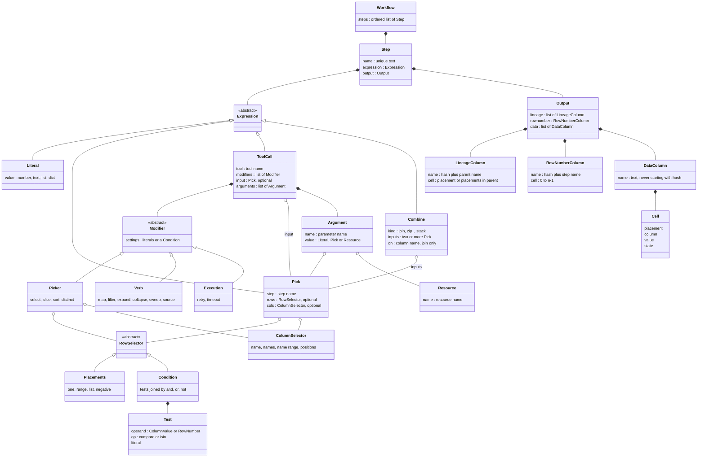
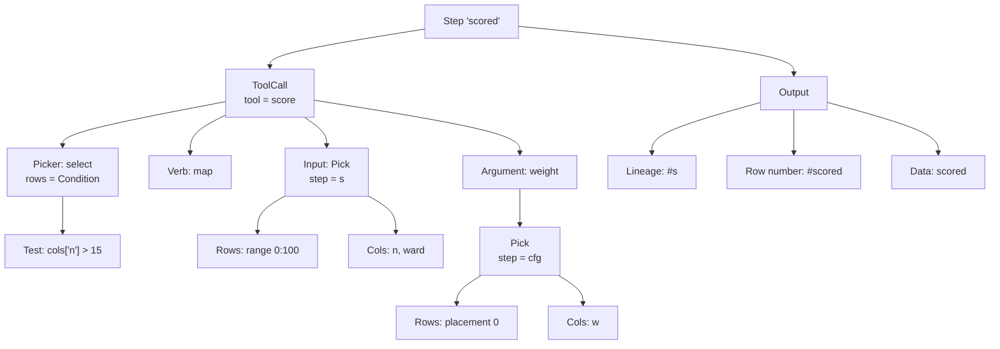
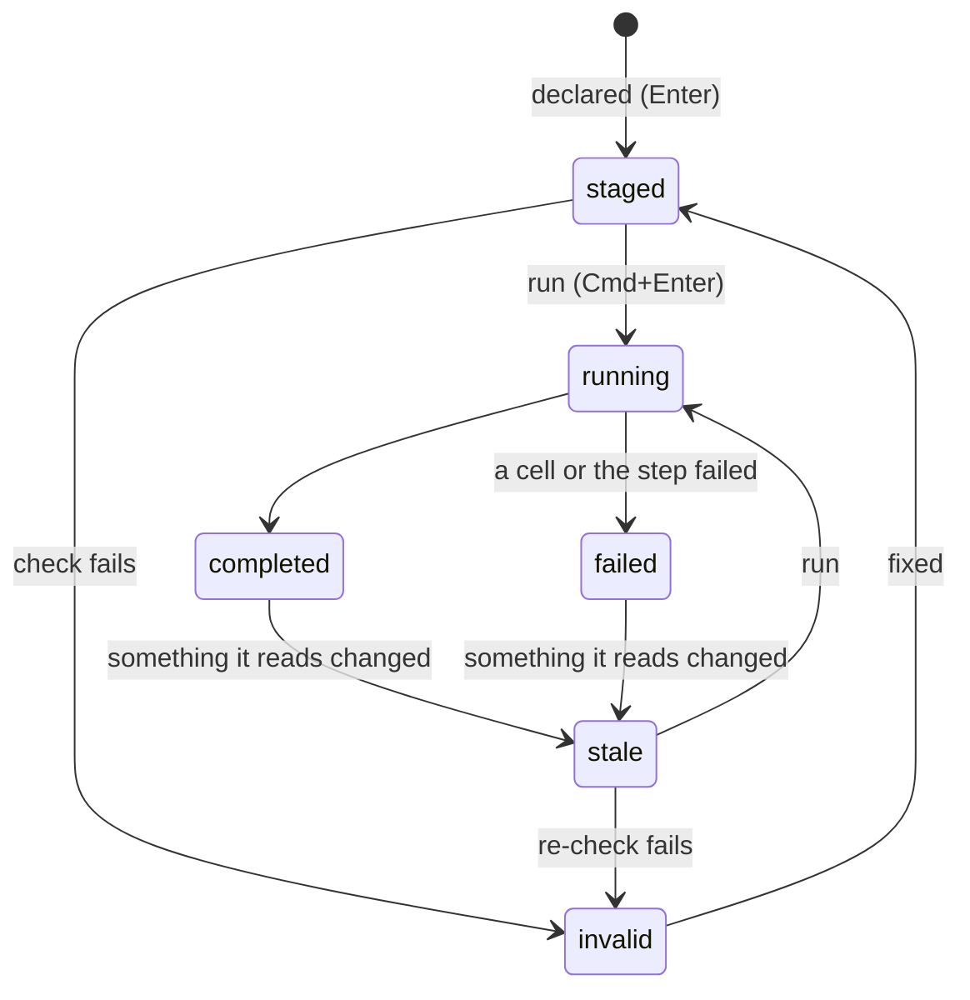
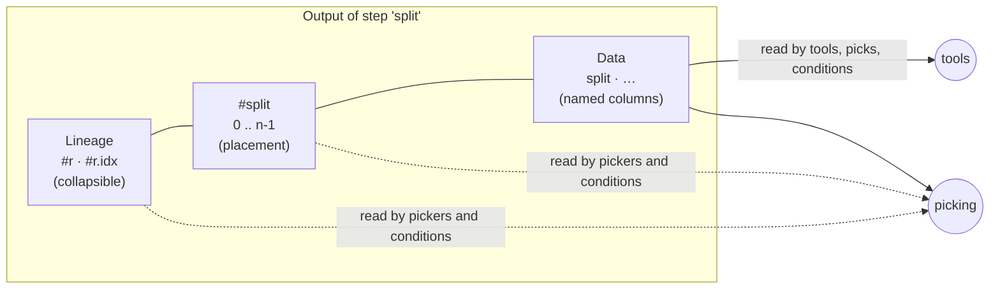
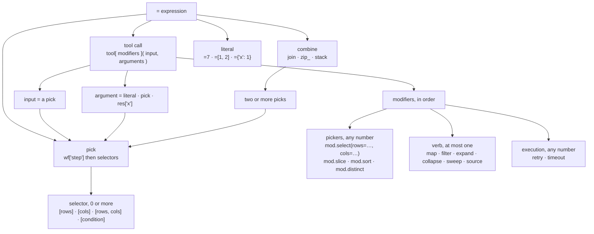
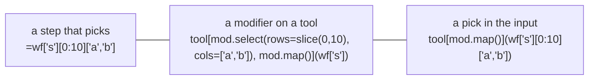

# The model and the ruleset

> The target for core: objects, definitions and rules for steps, picks and
> lineage. Agreed by the owner, 2026-11-02. Nothing here is built yet; the
> work and its tests are in [plan.md](plan.md). IDs such as R1, T4 or H-R2
> refer to the history in the app's
> [`docs/dev_plan/130-reference-selection.md`](../dev_plan/130-reference-selection.md).

## M1. Summary

A **workflow** is an ordered list of named **steps**. Each step holds one
**expression** and produces an **output**: a table with three parts, kept
apart. **Lineage** says which parent rows each row came from, **`#<step>`**
numbers the rows `0..n-1`, and **data** holds the named values. An expression
is a **literal**, a **pick** (part of an earlier step), a **tool call**, or a
**combine** of several steps. A pick reads like a list and a dict: integers
choose rows, strings choose columns, a condition chooses rows by value or by
row number. A tool call names a tool, a stack of **modifiers** (any number of
**pickers** that narrow the input, at most one **verb** that says how the tool
is applied, and execution wrappers), one **input** and named **arguments**.
Tools see only data. Rows from different steps meet only where the formula
says so: a combine, or a pick. Nothing fails silently.

## M2. Object model



## M3. Definitions

**Structure**

| Term | Definition |
|---|---|
| Workflow | An ordered list of steps. A step reads only steps before it |
| Step | A unique name, one expression, and the output it produces |
| Expression | What a step does. Exactly one of: literal, pick, tool call, combine |
| Literal | A fixed value: `=7`, `=[1, 2]`, `={'x': 1}`. Its output is one cell |
| Pick | Part of an earlier step: `wf['step']` followed by up to one row selector and one column selector |
| Tool call | `tool[modifiers](input, arguments)`: run a tool over an input |
| Combine | `join`, `zip_` or `stack` of two or more picks into one output |

**Inside a pick**

| Term | Definition |
|---|---|
| Row selector | Which rows: placements or a condition |
| Placement | A row's position in its step's output, `0..n-1`. Written as an integer: `3`, `-1` (last) |
| Range | Rows `a` to `b-1`: `0:10`. In a modifier setting, `slice(0, 10)` |
| Placement list | Chosen rows in order: `[0, 2]` |
| Condition | A test that keeps the rows it's true for: `cols['n'] > 15`, `row['r'] == 3`, joined by `&`, `\|`, `~` |
| `cols['x']` (in a condition) | This row's value in data column `x` |
| `row['s']` (in a condition) | This row's placement in step `s`: its own `#s`, or its lineage `#s` if `s` is a parent |
| Column selector | Which data columns: a name `'n'`, names `'a', 'b'` or `['a', 'b']`, a name range `cols['a':'c']`, or positions `cols[0:2]` |
| `rows[…]`, `cols[…]` | The explicit spellings of a row or column selector, for when the plain form would be unclear |

**Inside a tool call**

| Term | Definition |
|---|---|
| Tool | A function; its parameters are what it reads |
| Modifier | `mod.<name>(settings)` in the brackets. Three kinds: picker, verb, execution |
| Picker | Narrows the input before the tool runs: `select`, `slice`, `sort`, `distinct`. Any number, applied in order |
| Verb | How the tool is applied, and so what the output rows are: `map` (each row), `filter` (keep rows the tool approves), `expand` (each row into several), `collapse` (groups into one), `sweep` (every combination of settings), `source` (no input). At most one |
| Execution modifier | Wraps each call: `retry`, `timeout`. Changes nothing about rows |
| Setting | A keyword inside a modifier: a literal, a column name as text (`by='ward'`, `by='#r'`), or a condition (`select(rows=…)`) |
| Input | The positional argument: a pick, the data the step works over. Its data columns bind to the tool's parameters by name |
| Argument | A keyword in `( )`: a literal, a pick, or a resource |
| Resource | `res['x']`: a live object (a model, a folder) a tool uses |

**Inside an output**

| Term | Definition |
|---|---|
| Output | A table in three parts: lineage, row number, data |
| Lineage column `#<parent>` | One per parent step. Each cell: the parent placement(s) this row came from, as they were when the step ran. Always an integer or a list of integers: one placement (filter, slice, sort, pick), a list (collapse, distinct). An expand adds a second column, `#<parent>.idx`: the item's index within the parent's cell. References only, never the parent's data. Read-only. Collapsible in the grid |
| Row number column `#<step>` | This row's placement, `0..n-1` |
| Data column | A named column of values. Names are unique text, never starting with `#`; unnamed or numeric names become `var<n>` |
| Cell | One value at (placement, data column), with a state: known, pending, running, failed, null, absent, stale |
| Aligned | Two steps whose rows are the same rows in the same order: one step, or connected only through `map` and other one-to-one steps |
| Row id | Core's internal identity for a row. Never shown or written |

## M4. The ruleset

**Hard rules** are enforced: breaking one refuses the formula or fails the
step, and is never silently reinterpreted. **Soft rules** give a warning or a
hint.

**Steps and expressions**

| # | Hard rule |
|---|---|
| 1 | Step names are unique; a step reads only steps **earlier** in the workflow. A reference to itself or a later step is refused |
| 2 | An expression is a literal, a pick, a tool call or a combine. Nothing else |
| 3 | The only way to refer to a step is `wf['step']`. A bare name or a string is never a reference |
| 4 | `wf['step']` on its own is a reference, not a step; to copy a step write `=wf['step'][:]` |
| 5 | Every output is a table; a single value is a one-cell table |

**Picks**

| # | Hard rule |
|---|---|
| 6 | Integers choose rows, by placement, as in a Python list. Strings choose columns, as in a dict |
| 7 | A pick has at most one row part and one column part, in either order, in one bracket or two. A list mixing integers and strings is refused |
| 8 | A pick covers data only: never `#<step>` or lineage columns |
| 9 | A condition uses only `cols['x']`, `row['s']`, comparisons, `.isin`, `&`, `\|`, `~`, brackets and literals. It's read by the parser, never run as code |
| 10 | A condition reads the step it picks from: its data, its row numbers and its lineage. Values of another step need a combine first |
| 11 | A pick that matches nothing fails, naming what it looked for |

**Tool calls**

| # | Hard rule |
|---|---|
| 12 | Modifiers: any number of pickers, at most one verb, any number of execution modifiers. Pickers apply to the input, in order, before the verb |
| 13 | The input is a pick. Every verb except `source` and `sweep` needs one |
| 14 | The input's data columns bind to the tool's parameters by name, never by type. A missing name is refused, listing the columns there are |
| 15 | Arguments are literals, picks or resources. A tool never receives a `#` column or a column name as text |
| 16 | What an argument pick passes is decided by the **verb**, never the parameter's type: one cell passes its value; a column under `map` / `filter` / `expand` passes each row's cell (only if the steps are aligned); under one call (`source`) the whole column as a list; under `collapse` the group's values. A type that doesn't fit is refused. A table passes only to a `DataFrame` parameter |
| 17 | Settings are literals, column names as text (`#` names allowed), or a condition in `select(rows=…)`. Never a pick or a resource |

**Combines**

| # | Hard rule |
|---|---|
| 18 | `join` pairs rows by a column's values (`on='ward'`) or by lineage (`on='#r'`: each child with its parent row) |
| 19 | `zip_` pairs row `i` with row `i`, and only for aligned steps |
| 20 | `stack` puts the inputs' rows one after another |
| 21 | A combine has one lineage column per input. When an input is itself a combine, its lineage columns are carried forward. The same parent twice is numbered `#r`, `#r.2` |

**Outputs and cells**

| # | Hard rule |
|---|---|
| 22 | Every output has `#<step>` = `0..n-1` |
| 23 | Lineage holds parent placements only (integers or lists of integers), never the parent's data. A step that isn't one-to-one has one lineage column per parent; an expand adds `#<parent>.idx` |
| 24 | Data column names are unique text, never starting with `#`; unnamed or numeric names become `var<n>` |
| 25 | Lineage is read-only: never renamed, dropped or edited. It becomes data only by copying it into a new column: `mod.copy(columns={'#r': 'parent'})` |
| 26 | No silent results: a missing pair, a failed call or an empty pick is a failed cell or a refused step, never a null |
| 27 | The same text always means the same data, whatever the tool's types or the run state |
| 28 | **An output's columns are of two kinds, told apart by name.** A name starting with `#` is lineage or a row number, always `#` followed by a step name (`#r`, `#split`, `#r.2`). Every other name is data. In the grid, the lineage columns collapse and expand as a group |

| # | Soft rule |
|---|---|
| S1 | Many spellings are accepted; the grid, picks and hover always show the list/dict-style one (`wf['s'][0:10]['a', 'b']`) |
| S2 | Hover on a pick shows the cells it covers and what the tool gets: a value, a row's value, a list or a table |
| S3 | When a re-run puts a different row at a picked placement, the step is flagged "reference moved" |
| S4 | When a step has a column argument and no written verb, the inferred verb is written into the formula |
| S5 | The grid shows lineage (collapsed), `#<step>` and data apart. Each data header says whether the tool read it, the step made it, or it passed through |
| S6 | Clicking a lineage cell highlights the parent rows; it never writes a pick |
| S7 | A tool should read data through its parameters, not take a column name to look up |
| S8 | An int column shouldn't become float because a value is missing; at least warn |

## M5. One formula as objects

`=score[mod.select(rows=cols['n'] > 15), mod.map()](wf['s'][0:100]['n', 'ward'], weight=wf['cfg'][0]['w'])`



Order of work: pick the input (rows 0–99, columns `n`, `ward`) → the picker
keeps rows with `n > 15` → `map` calls `score` once per row, with `n` bound by
name and `weight` the one cell → the output's `#s` records which row of `s`
each result came from.

## M6. Naming conventions and defaults

| Thing | Convention | Default | Rules |
|---|---|---|---|
| Step | `snake_case` noun for what the output holds: `readings`, `per_ward`, `scored` | the tool's name when created (`double`), then `double_2`, … | Unique. Not a reserved name. Never starts with `#`. Renaming rewrites every `wf['old']` |
| Tool | `snake_case` verb: `double`, `load_csv`, `score` | the function's name | Not a reserved name |
| Resource | `snake_case` noun: `llm`, `workspace` | — | Not a reserved name |
| Reserved names | `wf`, `res`, `mod`, `rows`, `cols`, `row`, `op`, `join`, `zip_`, `stack` | — | No step, tool or resource may use one |
| Data column made by a tool | `snake_case` | one value or one column: the **step's name** (core says `value` today); `mod.name('x')` sets it | A tool returning a dict: one column per key (today the dict stays in one cell). Unnamed parts: `var0`, `var1`, … unless renamed |
| Data column passed through (filter, sort, pick) | keeps its name | — | — |
| Data columns from a combine | keep their names | — | The same name from two inputs is refused, naming both; rename one first (`join`'s `on` column is the exception) |
| Numeric or empty name | — | `var<n>` | `0` and `'0'` both become `var0`; a clash is refused |
| Row number | — | `#<step>` | Always |
| Lineage | — | `#<parent>`; `#<parent>.idx` after an expand; `#<parent>.2` for the same parent twice | Always |

A data column whose name isn't a valid Python name (`'my col'`, `'2023-x'`)
can be picked (`wf['s']['my col']`) but can't bind to a tool parameter by
name; the refusal offers a rename. `snake_case` avoids that.

A column named after its step by default follows the step when it's renamed.
A whole-step reference (`wf['pairs']`) to a step with several columns passes
them all: as an input they bind by name; as an argument to a one-value
parameter it's refused until one column is picked (`wf['pairs']['a']`).

## M7. An interactive session: editing steps and what changes downstream

Step states (core's names, run 2026-11-02):



| Edit | The edited step | Every step that reads it, directly or not |
|---|---|---|
| Change its formula (Enter) | re-checked: `staged` or `invalid`, old values kept until it runs | `stale`; old values kept, dimmed, with "changed upstream: <step>" |
| Run it (Cmd+Enter) | `running` → `completed` or `failed` | stay `stale` until run; "run stale" runs them in order |
| Change a source's data | `stale` | `stale` |
| A column a reader binds or picks disappears | — | `invalid` at once, naming the column (core today: `stale`, no problem, until run) |
| Rows move (placements shift) | — | `stale`, and "reference moved" on picks whose row changed (S3) |
| Rename the step | references rewritten; output kept (a rename isn't a recompute) | unchanged |
| Move the step | allowed only if every reader stays after it (rule 1) | — |
| Delete the step | refused while something reads it, naming the reader (core today) | — |

Rules for the session:

1. **Nothing is replaced silently.** A step's old values stay, dimmed and
   marked stale, until it runs again.
2. **The reason is always shown:** which upstream step changed, which column
   went missing, which reference moved.
3. **Checking is immediate; running is on request.** An edit re-checks every
   step downstream at once (cheap, no tools run); values change only when
   the user runs.
4. **Runs go in workflow order,** so a step never runs on a stale input.

## M8. Notes for later

- **Join variants.** Left, right and outer joins work in core today
  (`join(…, how=…)`). Merge is open. Lineage: one `#<input>` per side, empty
  where a side had no match. Today `join` adds `_left` / `_right` suffixes to
  clashing column names; the naming rules above refuse a clash instead.

---

# Worked examples

The model above, applied.

## What a step's output looks like



## The grammar



## Selectors: list and dict style

A plain bracket tells rows from columns **by type**: integers are rows,
strings are columns. `rows[…]` and `cols[…]` are the explicit spellings.

| Selects | List / dict style | Explicit |
|---|---|---|
| one row | `wf['s'][3]` | `wf['s'][rows[3]]` |
| rows 0–9 | `wf['s'][0:10]` | `wf['s'][rows[0:10]]` |
| rows 0 and 2 | `wf['s'][[0, 2]]` | `wf['s'][rows[[0, 2]]]` |
| last row | `wf['s'][-1]` | `wf['s'][rows[-1]]` |
| one column | `wf['s']['n']` | `wf['s'][cols['n']]` |
| two columns | `wf['s']['a', 'b']` or `wf['s'][['a', 'b']]` | `wf['s'][cols[['a', 'b']]]` |
| a block | `wf['s'][0:10]['a', 'b']` | `wf['s'][rows[0:10], cols[['a', 'b']]]` |
| a cell | `wf['s'][3]['n']` | `wf['s'][rows[3], cols['n']]` |
| rows by condition | `wf['s'][cols['n'] > 15]` | `wf['s'][rows[cols['n'] > 15]]` |
| rows by lineage | `wf['s'][row['r'] == 3]` | same |
| an expanded item | `wf['s'][row['r'].idx == 1]` | same |

Order is free (`wf['s']['n'][3]` is the same cell). Refused: a list mixing
numbers and strings (`[0, 'a']`), two row parts, two column parts.

## Conditions

One small grammar, the same in a selector and in `mod.select(rows=…)`:

| Part | Means |
|---|---|
| `cols['x']` | this row's value in data column `x` |
| `row['s']` | this row's placement in step `s`: its own `#s`, or its lineage `#s` if `s` is a parent |
| `row['s'].idx` | the item's index from `#s.idx`, after an expand |
| `==` `!=` `<` `<=` `>` `>=` | compare to a literal |
| `.isin([…])` | one of these |
| `&` `\|` `~` `( )` | and, or, not, grouping |

Nothing else: no function calls, no other names. The parser reads it; it's
never run as Python. The one exception is `slice(a, b)`, the spelling of a
row range inside `mod.select(rows=…)`, where `a:b` isn't valid Python.

## The same selection, three places



All three select the same cells. Picks and the hover always show the first,
list-style form. Pickers and picks can be mixed in one step; they apply in
order: input pick first, then each `mod.select`, then the verb.

## What an argument passes

| Verb | A column passed as an argument gives each call… |
|---|---|
| `map`, `filter`, `expand` | its own row's cell, whatever it holds (a list, if that cell is a list) |
| one call (`source`, no input) | the whole column, as a list |
| `collapse` | its group's values, as a list |

```
add_k[mod.map()](wf['r'], k=wf['r']['n'])       # each row's n            → 20, 40, 60, 80
total_of[mod.source()](k=wf['r']['n'])          # the whole column, once  → 100
total_of[mod.map()](wf['g2'])                   # cells hold lists: each summed
add_all[mod.map()](wf['r'], k=wf['r']['n'])     # refused: k is a list, each row's cell is an int
```

## Merging steps

| Write | Rows | Lineage |
|---|---|---|
| `=join(wf['a'], wf['b'], on='ward')` | matched by the column's values | `#a`, `#b` |
| `=zip_(wf['a'], wf['b'])` | row `i` beside row `i`; only if aligned | `#a`, `#b` |
| `=stack(wf['a'], wf['b'], wf['c'])` | one after another | `#a`, `#b`, `#c` |
| a combine of a combine | as above | the inner combine's lineage carried forward |
| `=join(wf['split'], wf['r'], on='#r')` | each child with its parent's data | `#split`, `#r` |

Each input can be a pick: `join(wf['a'][0:10], wf['b']['ward', 'pop'], on='ward')`.

## The rules, short

1. A **reference** is `wf['step']` plus selectors. Nothing else refers to a step.
2. **Rows are placements**, `0..n-1`, like a Python list. Integers select rows.
3. **Strings select columns**, like a dict. `cols[…]` and `rows[…]` are the explicit forms.
4. **A condition chooses rows**, from data (`cols['x']`) or row numbers (`row['s']`).
5. **Tools receive data only**: never `#` columns, never column names as text.
6. **Pickers narrow the input; one verb applies the tool;** execution modifiers wrap the call.
7. **The same text always means the same data**, whatever the tool's types.
8. **Rows from different steps pair only when written:** `join`, `zip_` (aligned only), or a pick that names them.
9. **Every result is visible**: no match and no pair is a failed cell, never a silent null.
10. **Many spellings, one display**: any listed form is accepted; the grid and hover show the list-style one.
